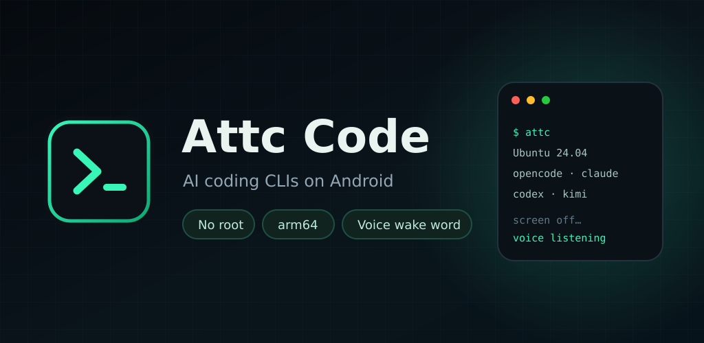
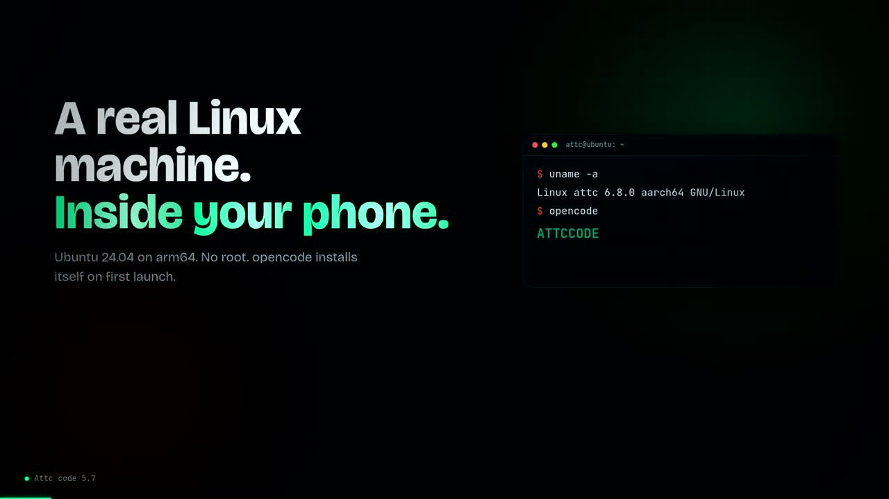
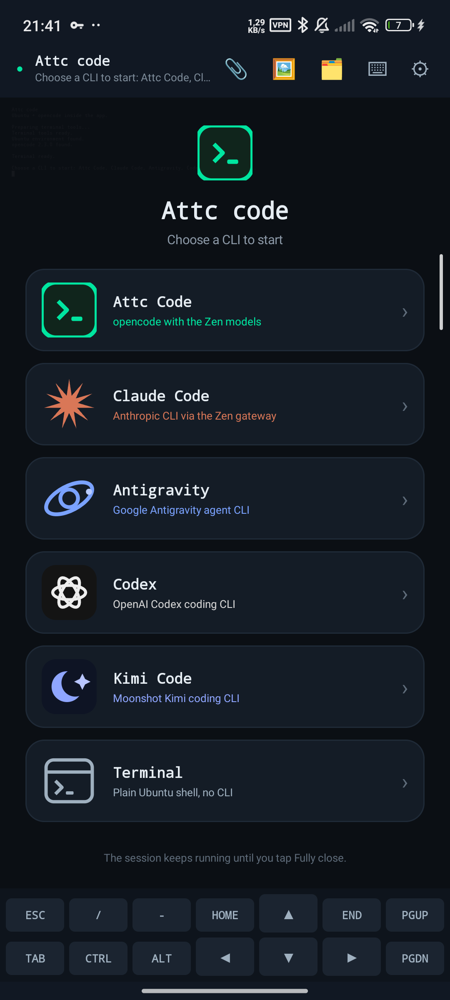
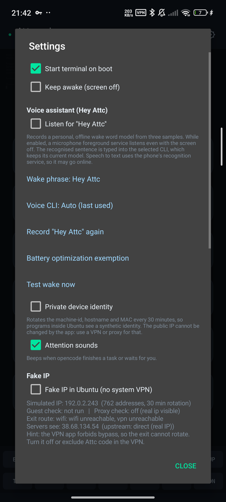

<p align="center">
  
</p>

<h1 align="center">Attc Code</h1>

<p align="center">
  <strong>Cebinizde gerçek bir Ubuntu 24.04 arm64 terminali.<br>
  opencode, Claude Code, Codex, Kimi ve Antigravity — root gerekmez.</strong>
</p>

<p align="center">
  <a href="https://github.com/Attc-Config-Technician/Attc-Code/releases/latest"></a>
  
  
  
</p>

<p align="center">
  <a href="docs/assets/attc-code-ad.mp4">▶ Tanıtım filmini izle (52 sn)</a> ·
  <a href="https://attc-config-technician.github.io/Attc-Code/">Web sayfası</a> ·
  <a href="https://github.com/Attc-Config-Technician/Attc-Code/releases/latest">APK indir</a>
</p>

<p align="center">
  <a href="docs/assets/attc-code-ad.mp4"></a>
</p>

---

## Türkçe

**Attc Code**, Android telefonunuzda proot tabanlı gerçek bir **Ubuntu 24.04 arm64** ortamı açar ve içinde yapay zekâ kodlama CLI'lerini çalıştırır. Root gerekmez; uygulama normal bir Android uygulaması olarak kurulur. Shizuku isteğe bağlıdır ve yalnızca telefon kontrolü (uygulama açma, medya, dokunma) için gerekir.

Her soğuk açılışta hangi CLI'yi başlatacağınızı seçersiniz:

| CLI | Ne yapar? |
|---|---|
| **Attc Code** | opencode + Zen modelleri |
| **Claude Code** | Anthropic CLI, uygulama içi Zen ağ geçidi üzerinden |
| **Antigravity** | Google Antigravity agent CLI |
| **Codex** | OpenAI Codex coding CLI |
| **Kimi Code** | Moonshot Kimi coding CLI |
| **Terminal** | Düz Ubuntu shell |

### “Hey Attc” sesli asistanı (5.16)

- **Ekran kapalıyken dinler.** Mikrofon tipli foreground service + kısmi CPU wake lock; boot sonrası otomatik başlar. Telefon tamamen kapalıyken çalışmaz.
- **Uyanma kelimesi sizin sesinizle, çevrimdışı.** Üç örnek kayıttan MFCC/DTW modeli çıkarılır; bulut veya API anahtarı gerekmez. “attc” hazır sözlüklerde olmadığı için genel ASR yerine konuşmacıya özel eşleştirme kullanılır.
- **Kelime ayarlardan seçilir.** “Hey Attc”, “Hey Attc Code”, “Merhaba Attc”, “Selam Attc” veya özel metin. Kelime değişince eski kayıtlar geçersiz olur ve yeniden kayıt istenir.
- **Türkçe komut → seçili CLI.** Google konuşma tanıma (tr-TR) cümleyi yazıya çevirir; metin seçili CLI'nin **son kullandığınız modeldeki** oturumuna yazılır. Oturum yoksa CLI başlatılır.
- **Telefon kontrolü.** `attc-ctl` yardımcısı, Shizuku shell üzerinden `am`, `input`, `uiautomator`, `cmd media_session` gibi komutları çalıştırır. “YouTube Music'i aç ve şu şarkıyı çal” gibi istekler ajana bu araçla iletilir.
- **İzin akışı.** Ses özelliği varsayılan kapalıdır; açınca mikrofon izni istenir, reddedilirse uygulama ayarlarına yönlendirilir.

Kurulum: **Ayarlar → Voice assistant → Listen → mikrofon izni → üç kez uyanma kelimesini söyle → Wake phrase ile kelimeyi seç.**

> Konuşma tanıma, cihazdaki Google servisine gidebilir. Uyanma kelimesi algılama tamamen çevrimdışıdır; ses kayıtları telefondan çıkmaz.

### Ekranlar

| CLI seçimi | Ayarlar / sesli asistan |
|---|---|
|  |  |

### Kurulum

1. [Releases](https://github.com/Attc-Config-Technician/Attc-Code/releases/latest) sayfasından imzalı APK'yı indirin (Android 8.0+, arm64).
2. Bilinmeyen kaynak iznini yalnızca bu kurulum için açıp APK'yı yükleyin.
3. Uygulamayı açın, CLI seçin; Ubuntu kök dosya sistemi ve seçtiğiniz CLI hazırlanır.
4. İsteğe bağlı: Shizuku kurup Attc Code'a izin verin; pil muafiyeti ve sesli asistanı açın.

Son teslim: `ATTC-CODE-5.16.apk` — `versionCode 83`, `versionName 5.16`  
sha256: `85f8ac71a5e029a8ee6165b611b38c4aba49bf21ee27b9b4b92e525148ff4a12`

### F-Droid

Depo **GPL-3.0-or-later** ile lisanslanmıştır. F-Droid için gerekli `fastlane` metinleri, ekran görüntüleri, tanıtım videosu ve tarif taslağı `fastlane/` ile `fdroid/` altında hazır. Resmî F-Droid listelemesi, F-Droid'in kendi derleme sunucusunda üretilen APK'yı gerektirir; başvuru adımları ve derleme uyarlaması için [fdroid/README.md](fdroid/README.md).

### Derleme

Gradle kullanılmaz. Termux'ta `aapt2`, `d8`, `apksigner`, `javac`, `android.jar` ve proot ikilileriyle tek betik yeterlidir:

```bash
git clone https://github.com/Attc-Config-Technician/Attc-Code.git
cd Attc-Code
VERSION_CODE=83 VERSION_NAME=5.16 bash tools/build.sh
```

Çıktı `dist/ATTC-CODE-5.16.apk`; cihaz varsa `/storage/emulated/0/ATTC OPENCODE/` altına da kopyalanır. Ortam değişkenleri: `ANDROID_JAR`, `FRAMEWORK`, `TERMUX_PREFIX`, `OUT_DIR`, `KS_FILE`, `KS_PASS`.

### Nasıl çalışır?

- **proot + Ubuntu 24.04 arm64** kök dosya sistemi uygulama özel dizininde tutulur; `/sdcard`, `/storage/emulated/0`, `/mnt` ve `/system` misafir ortama bağlanır.
- **PTY** JNI ile açılır; terminal görünümü VT100/xterm uyumludur.
- **Foreground service** oturumu, bildirimi ve wake lock'ları yönetir.
- **VoiceEngine** 16 kHz mono kayıt, 25 ms pencere / 10 ms hop, FFT-512, 26 mel, 13 MFCC, adaptif enerji VAD ve Sakoe-Chiba bantlı DTW kullanır.
- **VoiceBridge** `/root/attc/ctl` altındaki dosya kuyruğunu izler; isteği Shizuku shell'de çalıştırıp sonucu geri yazar.
- **Shizuku** yoksa yalnızca telefon kontrolü devre dışı kalır; terminal ve CLI'ler çalışmaya devam eder.

### Sınırlamalar

- Yalnızca **arm64** cihazlar; Android 8.0+.
- Telefon kapalıyken veya uygulama zorla durdurulmuşken sesli asistan çalışmaz.
- proot bir emülatör değildir; bazı çekirdek özellikleri (ör. gerçek mount, bazı DRM uygulamaları) kısıtlıdır.
- YouTube Music gibi uygulamalarda derin bağlantı davranışı sürüme göre değişebilir; köprü `am start` çıktısını ajana döndürür.
- Konuşma tanıma için cihazda Google konuşma servisi gerekir; yoksa uygulama hata bildirir.

---

## English overview

**Attc Code** boots a real **Ubuntu 24.04 arm64** userland on Android with proot — no root — and runs AI coding CLIs inside it. A cold start asks which CLI to launch: **Attc Code (opencode + Zen)**, **Claude Code**, **Antigravity**, **Codex**, **Kimi Code**, or a plain **Terminal**.

**Voice (5.16).** Say “Hey Attc” with the screen off. The wake word is a personal, fully offline MFCC/DTW model built from three recordings; the phrase itself is selectable in Settings (presets or custom text). The recognised Turkish sentence is typed into the selected CLI session, keeping the model you last picked there. With Shizuku, the bundled `attc-ctl` helper lets the agent open apps and control media through shell commands.

**Status.** Signed APK 5.16 (versionCode 83), sha256 `85f8ac71a5e029a8ee6165b611b38c4aba49bf21ee27b9b4b92e525148ff4a12`. F-Droid metadata and a draft recipe are included; the official listing still needs a reproducible build on F-Droid's build server (see [fdroid/README.md](fdroid/README.md)).

**License.** GPL-3.0-or-later. Third-party names and trademarks belong to their owners; this project is independent.

---

<p align="center">
  <sub>Built for people who want a real terminal in their pocket.</sub>
</p>
